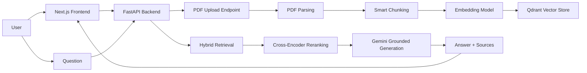

# Iceberg AI


A production-style hybrid RAG application for research and document-grounded Q&A. Upload PDFs, build a searchable knowledge base, retrieve the most relevant excerpts, and generate answers backed by citations and source context.

Iceberg combines a Python FastAPI backend, semantic search in Qdrant, lexical BM25 retrieval, reranking, and Gemini-based grounded generation. The frontend is a modern Next.js interface for upload, chat, and source-aware responses.

## Why this project exists

Most generative AI systems answer from broad model knowledge, which makes them prone to hallucinations and weak evidence. Iceberg is designed to keep answers grounded in uploaded documents by using a retrieval pipeline before generation.

The result is a workflow that is useful for:

- research assistants
- internal knowledge-base search
- document Q&A
- PDF summarization
- citation-aware AI workflows

---

## Features

- PDF upload and ingestion
- Smart document chunking with overlap preservation
- Semantic vector retrieval with Qdrant
- BM25 keyword retrieval for lexical matching
- Hybrid search fusion and reranking
- Citation-aware grounded answers
- Streaming AI responses over SSE
- Minimal but modular service-oriented architecture
- Modern frontend dashboard for document exploration and chat

---

## Architecture overview



---

## Tech stack

| Layer       | Stack                                   |
| ----------- | --------------------------------------- |
| Frontend    | Next.js, React, Tailwind CSS, shadcn/ui |
| Backend     | FastAPI, Python                         |
| LLM         | Google Gemini 2.5 Flash                 |
| Retrieval   | Qdrant, semantic search, BM25           |
| Embeddings  | SentenceTransformers                    |
| PDF parsing | PyMuPDF                                 |
| Chunking    | LangChain text splitters                |
| Streaming   | SSE via sse-starlette                   |

---

## Repository structure

```text
iceberg/
├── backend/
│   ├── app/
│   │   ├── ingestion/
│   │   ├── llm/
│   │   ├── rag/
│   │   │   ├── chunking/
│   │   │   ├── embeddings/
│   │   │   ├── retrieval/
│   │   │   ├── services/
│   │   │   └── vectorstore/
│   │   ├── routes/
│   │   └── main.py
│   ├── uploads/
│   ├── .env
│   ├── requirements.txt
│   ├── reset_collection.py
│   ├── test_bm25.py
│   ├── test_hybrid.py
│   ├── test_models.py
│   ├── test_qdrant.py
│   ├── test_reranker.py
│   ├── test_search.py
│   └── README.md
├── frontend/
│   ├── src/
│   ├── public/
│   ├── package.json
│   ├── next.config.ts
│   ├── tsconfig.json
│   └── README.md
├── .gitignore
├── LICENSE
├── README.md
└── backend/.env.example
```

---

## Prerequisites

Before starting the app, make sure you have:

- Python 3.10+
- Node.js 18+
- npm
- A Google Gemini API key
- A Qdrant instance (cloud or self-hosted)

---

## Quick start

### 1) Set up the backend

Open a terminal in the project root and run:

```powershell
# Move into the backend folder
cd backend

# Create a virtual environment for isolation
python -m venv .venv

# Activate it on Windows PowerShell
.\.venv\Scripts\Activate.ps1

# Install project dependencies
pip install -r requirements.txt
```

Create a `.env` file in the `backend/` folder. You can copy the example included in the repo:

```powershell
copy .env.example .env
```

Then update the values:

```env
# backend/.env
GEMINI_API_KEY=your_gemini_api_key
QDRANT_URL=https://your-qdrant-cluster.qdrant.io
QDRANT_API_KEY=your_qdrant_api_key
```

If you are using a local Qdrant instance instead of Qdrant Cloud, use a local URL such as:

```env
QDRANT_URL=http://localhost:6333
```

Then start the API:

```powershell
# Run the FastAPI server with live reload enabled
uvicorn app.main:app --reload
```

The backend will be available at:

- API: `http://127.0.0.1:8000`
- Swagger Docs: `http://127.0.0.1:8000/docs`

---

### 2) Set up the frontend

Open a second terminal:

```bash
# Move into the frontend app
cd frontend

# Install dependencies
npm install

# Start the Next.js development server
npm run dev
```

The frontend will be available at:

- Web app: `http://localhost:3000`

---

### 3) Use the app

1. Open the frontend in the browser.
2. Upload a PDF document.
3. Wait for the text extraction and embedding process to finish.
4. Ask a question about the document.
5. Review the final answer and the source citations.

> Both services must run together: the frontend calls the FastAPI backend, and the backend connects to Gemini and Qdrant.

---

## Environment variables

| Variable         | Required      | Description                     |
| ---------------- | ------------- | ------------------------------- |
| `GEMINI_API_KEY` | Yes           | API key for Google Gemini       |
| `QDRANT_URL`     | Yes           | Qdrant instance URL             |
| `QDRANT_API_KEY` | Yes for cloud | API key when using Qdrant Cloud |

---

## API reference

### `POST /upload`

Uploads a PDF file, extracts its text, chunks the content, creates embeddings, and stores them in Qdrant.

Example:

```powershell
# Upload a PDF file to the ingestion endpoint
curl.exe -X POST http://127.0.0.1:8000/upload `
  -F "file=@.\uploads\document.pdf"
```

Response example:

```json
{
  "filename": "document.pdf",
  "characters": 12345,
  "total_chunks": 42,
  "embedding_dimension": 384,
  "status": "stored in qdrant"
}
```

### `POST /rag`

Uses retrieval-augmented generation to answer a question grounded in uploaded material.

Example:

```powershell
# Ask a grounded question against the uploaded knowledge base
curl.exe -X POST http://127.0.0.1:8000/rag `
  -H "Content-Type: application/json" `
  -d "{\"message\": \"Summarize the key findings in this document.\"}"
```

Example response:

```json
{
  "answer": "The document explains...",
  "sources": [
    {
      "filename": "document.pdf",
      "chunk_index": 7,
      "score": 0.91,
      "preview": "..."
    }
  ]
}
```

### `POST /chat`

Streams a general Gemini response without document grounding.

```powershell
curl.exe -N -X POST http://127.0.0.1:8000/chat `
  -H "Content-Type: application/json" `
  -d "{\"message\": \"Hello!\"}"
```

### `POST /rag/stream`

Streams the grounded answer chunk by chunk for the frontend UI.

```powershell
curl.exe -N -X POST http://127.0.0.1:8000/rag/stream `
  -H "Content-Type: application/json" `
  -d "{\"message\": \"Explain the main risks in this report.\"}"
```

---

## How the retrieval pipeline works

1. A PDF is uploaded through the frontend or API.
2. The backend extracts text from the PDF.
3. Text is split into managed chunks with overlap to preserve context.
4. Each chunk is embedded into a vector representation.
5. Matching chunks are retrieved via semantic similarity and BM25 keyword search.
6. The results are merged and reranked for relevance.
7. Gemini receives the top results as context and produces a grounded answer.
8. Source metadata is returned to the UI for citation display.

This is the core pattern that turns a raw document into a retrieval-ready knowledge source.

---

## Development notes

The project is intentionally modular so it can grow without tightly coupling retrieval, storage, and generation logic.

Key areas:

- `backend/app/routes/` handles HTTP endpoints
- `backend/app/rag/` contains chunking, embeddings, retrieval, and service logic
- `backend/app/llm/` handles the Gemini client and streaming
- `frontend/src/services/` communicates with the API
- `frontend/src/components/` renders the upload and chat experience

---

## Roadmap

Planned improvements include:

- conversation memory and session continuity
- multi-document workspace support
- stronger ingestion and evaluation pipelines
- improved observability and tracing
- async background ingestion jobs
- optional local model support and multi-model routing

---

## Contributing

Contributions are welcome. If you want to improve the project:

1. Fork the repository
2. Create a feature branch
3. Make your changes
4. Run the relevant checks locally
5. Open a clean pull request with a clear description

---

## License

This project is licensed under the MIT License. See the [LICENSE](LICENSE) file for details.

---

## Acknowledgements

This project is built around modern retrieval-augmented generation patterns and uses open-source tooling for PDF parsing, chunking, embeddings, vector search, and model-based generation.
